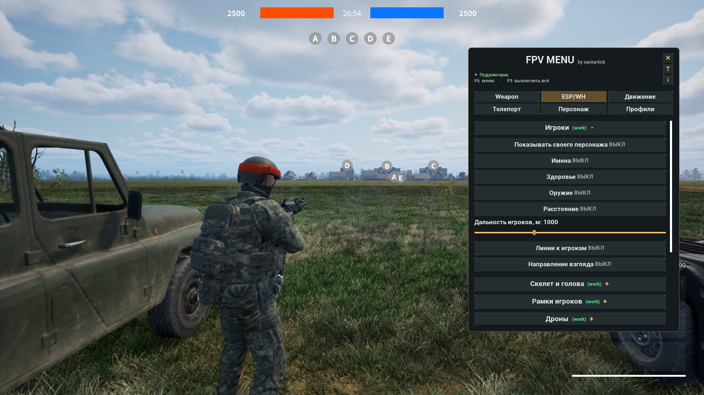
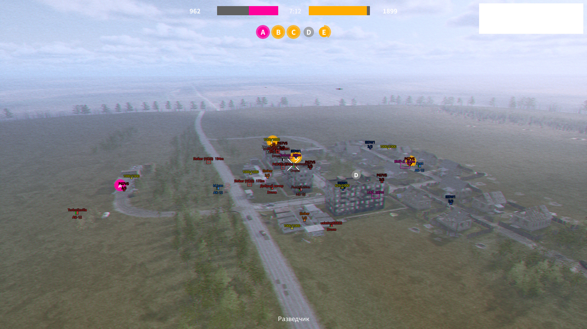
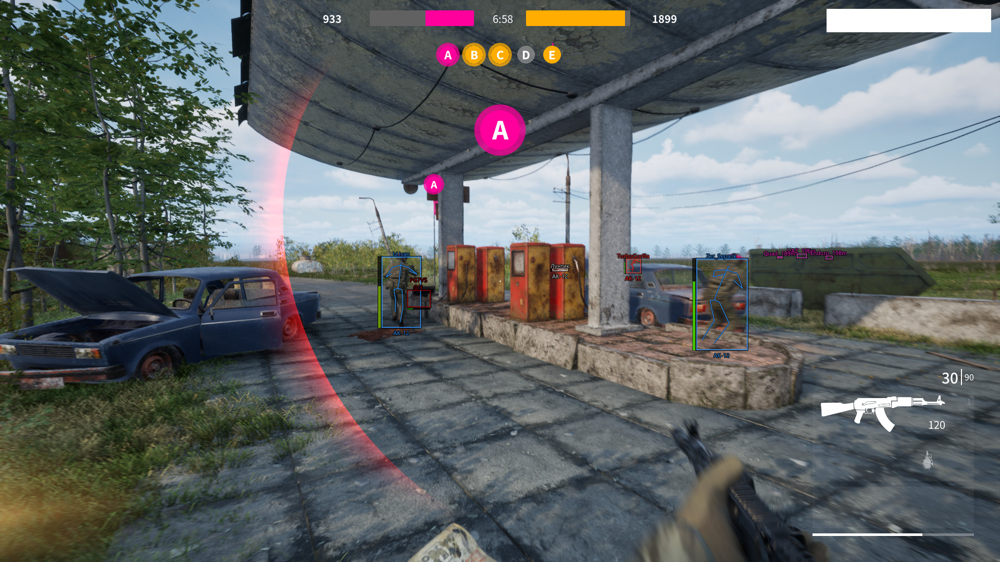
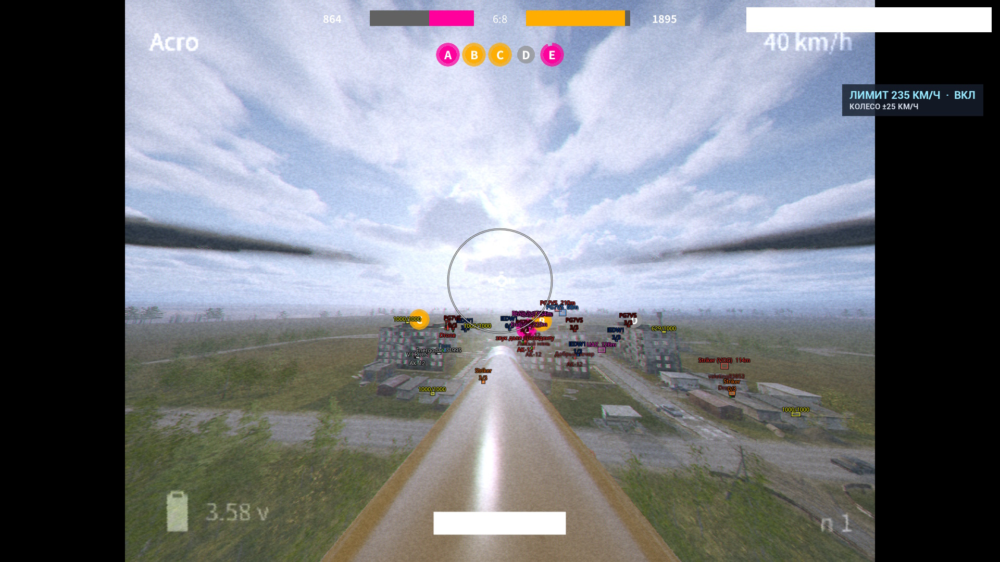
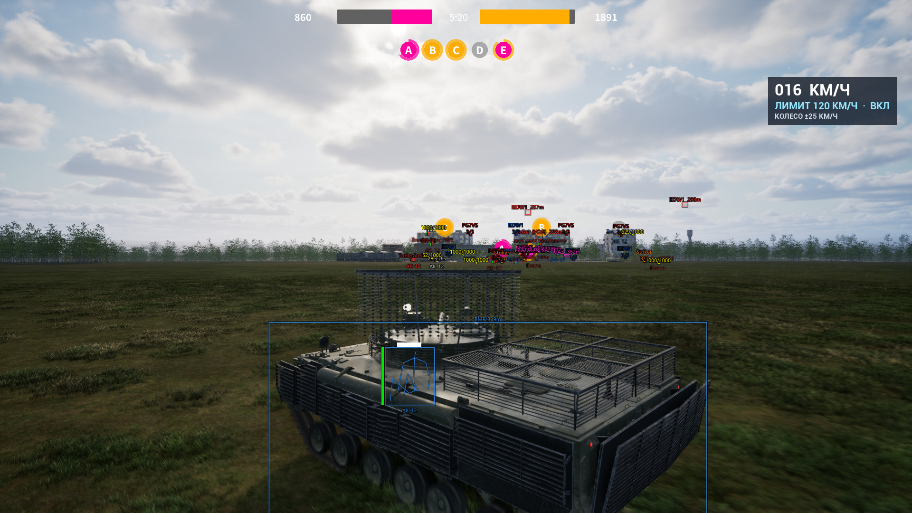

  <h1>FPV MENU</h1>
  
<strong>t.me/fpvmenu   by sanitar4ick</strong>

  
FPV Kamikaze Drone · v.1.0 (release)

  
WEAPON / ESP / MOVEMENT / TELEPORT

---

**FPV MENU** — внутриигровое чит-меню с AIM, ESP/WH, ускорением техники, телепортами и сохранением настроек.

## 01 / Установка

1. Скачай прикреплённый архив **FPV-MENU-v1.0.zip**.
2. Распакуй его целиком в папку с доступом на запись. Сохрани структуру: папка **runtime** должна оставаться рядом с загрузчиком.
3. Запусти FPV Kamikaze Drone.
4. Запусти **FPVInGame-Load.exe** из распакованной папки.
5. Открой меню через **F6**. При желании загрузи профиль «Рекомендую».

При обновлении сначала полностью закрой игру. Не заменяй файлы уже загруженной сборки во время игры.

**Скачать архив можно на GitHub:** [**https://github.com/Sanitar4ick/FPV-MENU/releases/tag/v.1.0**](https://github.com/Sanitar4ick/FPV-MENU/releases/tag/v.1.0)

## 02 / Возможности

Меню можно перемещать за заголовок. Кнопка **T** переключает тему, **i** открывает справку. Наведи курсор на настройку на 1,5 секунды — появится описание её работы.

- **(work)** — проверено в своём лобби и на чужом сервере.
- **(partial)** — доступность зависит от сценария.
- **(only host)** — требуется собственное лобби.

<strong>Weapon — прицеливание и стрельба</strong>

**(work)**

- **Silent Aim** — коррекция направления выстрела без обычного поворота камеры.
- **Автоприцеливание и автострельба** по игрокам и дронам.
- **Фильтры целей**: только видимые, пропуск раненых, выбор игроков и дронов.
- **Огонь по своим** — отдельная настройка, по умолчанию выключена. Собственный персонаж исключён из целей.
- **Уменьшение разброса**.
- **Настройка наведения**: угол FOV, круг области поиска, дальность, плавность и клавиша активации.
- **Выбор частей тела**: голова, шея, грудь, таз, руки и ноги.

<strong>ESP/WH — игроки, техника и предметы</strong>

**(work)**

- **Игроки**: имена, здоровье, оружие, расстояние, скелет, отметка головы, линии к целям и направление взгляда.
- **Рамки и подсветка**: 2D/3D-боксы, подсветка моделей, отображение за препятствиями и режим только видимых моделей.
- **Дроны и транспорт**: названия, расстояния, цветовая маркировка транспорта по командам.
- **Ящики с дронами, боеприпасами и гранатами**: содержимое, таймеры пополнения и расстояния.
- **Гранаты**: расстояние и радиус поражения.
- **Настраиваемая дальность** для игроков и объектов.

**Погибшие персонажи и неактивные дроны отмечаются светло-серым.** Цвета, контуры и лёгкая заливка рамок настроены по умолчанию.

<strong>Движение — разгон, спидометр и управление скоростью</strong>

**Разгон транспорта (work)**

Ускоренный разгон управляемой машины при подаче газа. Настраиваются сила разгона и предел помощи — от 30 до 300 км/ч. Работает у хоста и на чужих серверах.

**Разгон ударного дрона (work)**

Дополнительное ускорение при подаче газа. Доступны сила ускорения, плавность нарастания, помощь в поворотах и предел помощи — от 30 до 400 км/ч. Работает у хоста и на чужих серверах; дрон наблюдателя не поддерживается.

**Спидометр и колесо мыши (work)**

Панель показывает скорость техники и выбранный предел помощи. Колесо изменяет предел на **25 км/ч за шаг**; значение синхронизируется с меню. Нужны управление техникой, включённый разгон и закрытое меню. Пешком прокрутка не меняет настройки ускорения.

Настройки разгона сохраняются после смерти персонажа и смены техники. Предел помощи — скорость, до которой действует дополнительное ускорение, а не жёсткий ограничитель физической скорости. Большие значения могут ухудшать управляемость.

**Ультрабег (only host)**

Ускорение пешего персонажа при удержании Shift, множитель от ×1 до ×10. Требуется собственное лобби: на чужом сервере движение откатывается.

<strong>Телепорт — Clickwarp и перемещение к транспорту</strong>

**Clickwarp (partial)**

Выбери точку назначения с маркером и расстоянием, затем подтверди перемещение.

- **В машине** — перемещается транспорт вместе с водителем. Проверено у хоста и на чужих серверах.
- **Пешком** — требуется собственное лобби. На чужом сервере персонажа возвращает назад.
- **СКМ или F10** — выбрать/отменить точку; **ЛКМ** — подтвердить; **Esc** — отменить.

Если нажатия колеса пропускаются, используй F10. Выбирай достаточно ровную поверхность. Подтверждение ЛКМ может сопровождаться обычным игровым выстрелом.

**К выбранному или ближайшему транспорту (only host)**

Список машин с названиями и расстояниями, обновление списка и перемещение к выбранной цели. **F7** — к ближайшей машине. Для устойчивого перемещения пешего персонажа требуется собственное лобби.

<strong>Персонаж — бессмертие</strong>

**(only host)**

Защита персонажа от урона в собственном лобби. **Включай режим пешком**: при переходе к управлению ударным дроном тело оператора остаётся защищённым.

Защита не делает сам дрон неуязвимым, не лечит и не воскрешает персонажа. После истечения игрового эффекта режим выключается. F9 снимает добавленную защиту. На чужом сервере режим недоступен.

<strong>Профили — свои настройки и готовый набор</strong>

Сохраняй, загружай и удаляй наборы настроек в отдельной вкладке. Профили охватывают Weapon, ESP/WH, движение, спидометр, управление колесом, Clickwarp и настройку защиты. Тема оформления хранится отдельно.

В комплекте есть профиль **«Рекомендую»**:

1. Открой вкладку «Профили».
2. Выбери «Рекомендую».
3. Нажми «Загрузить выбранный».

Профиль не включается автоматически и не снимает ограничений функций. Выбранная машина и точка телепорта не сохраняются. Для переноса своих наборов копируй папку **data/profiles** целиком.

## 03 / Управление

- **F6** — открыть/закрыть меню.
- **F9** — выключить функции, включая разгон, Clickwarp и защиту.
- **F7** — телепорт к ближайшему транспорту; требуется своё лобби.
- **СКМ / F10** — выбрать или отменить точку при включённом Clickwarp.
- **ЛКМ / Esc** — подтвердить или отменить Clickwarp.
- **Колесо вверх/вниз** — предел помощи разгону ±25 км/ч при включённой настройке.
- **Shift** — ультрабег при включённой функции в своём лобби.
- **F8** — обновить диагностический отчёт; это не перезагрузка меню.
- **Перетаскивание заголовка** — переместить окно.
- **Кнопка T** — сменить тему; **кнопка i** — открыть справку. (Это кнопки в углу меню, не горячие клавиши.)

## 04 / Вопросы и ограничения

**Что работает на чужом сервере?**

Прицеливание и автострельба, ESP/WH, разгон машин и ударных дронов, спидометр и регулировка колесом. Clickwarp — при управлении машиной.

**Почему после телепорта возвращает назад?**

Пешее перемещение на чужом сервере откатывается. Для телепорта пешком, перемещения к машине и ультрабега нужно своё лобби.

**Почему дрон остаётся уязвимым при бессмертии?**

Режим защищает тело персонажа, а не управляемый дрон.

**Как сообщить об ошибке?**

Укажи версию меню, свою роль — хост или гость, функцию и последовательность действий. Приложи скриншот или короткое видео. Для проблем с техникой укажи тип машины или дрона.

Статусы отражают проверенные сценарии текущей сборки. Совместимость с будущими обновлениями игры не гарантируется, но поддерживать чит я продолжу.

## 05 / Интеграции

В меню интегрирован [**Foenem Menu v0.51**](https://www.unknowncheats.me/forum/other-fps-games/747090-internal-foenem-menu-fpv-kamikaze-drone.html) от **boysack & mpfatxd** — прицеливание, стрельба и ESP/WH. Дополнительно реализованы фильтр огня по своим, маркировка неактивных целей и функции FPV MENU, описанные выше.

## 06 / Скриншоты

<strong>Скриншоты</strong>

 

---

  <strong>FPV MENU</strong> by sanitar4ick

